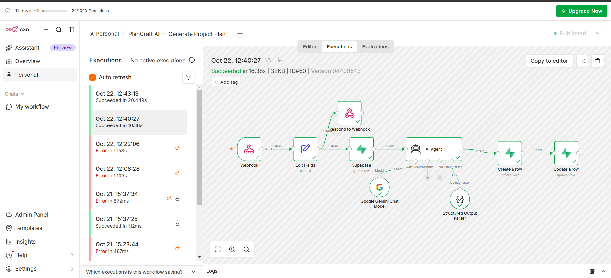
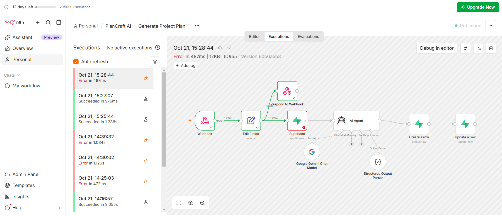
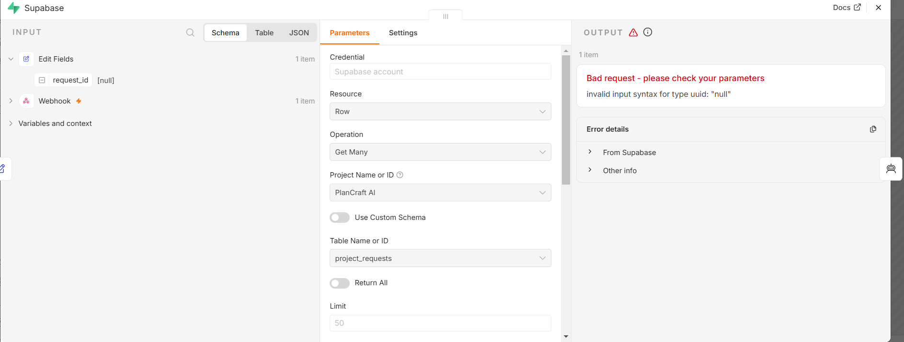

# PlanCraft AI

> Describe a project idea and get a structured, actionable plan — summary, goal, phases, recommended actions, risks, and estimated duration — generated by an AI workflow and saved to your plans.

**🌐 English** · [العربية](#-النسخة-العربية)


---

## ✨ Highlights

| | |
|---|---|
| 🔗 **A real integrated system** | Lovable app → n8n webhook → AI agent → Supabase → back to the app. Four components, each with one job. |
| ⏳ **Asynchronous by design** | The app answers immediately and shows *Processing*; n8n generates the plan in the background and the page updates when it is ready. |
| 🧱 **Structured AI output** | The AI agent must return a fixed JSON shape (Structured Output Parser) before anything is saved. |
| 🛠️ **Debugged end to end** | Five integration failures found and fixed — documented below with their root causes. |

---

## ⚙️ How It Works

```text
Lovable app (form)
  │  1. save request  → Supabase: project_requests (status = pending)
  │  2. POST { request_id } → n8n webhook
  ▼
n8n
  Webhook → Respond 202 (processing)
          → Edit Fields (request_id)
          → Supabase: read the request
          → AI Agent (Gemini + Structured Output Parser)
          → Supabase: create row in project_plans
          → Supabase: update request status = completed
  ▼
Lovable app polls the request → shows the plan
```

| Component | Responsibility |
|---|---|
| Lovable app | Form, plan list, plan page, status badge |
| Supabase | `project_requests` and `project_plans` (RLS enabled, constraints on status and JSON shape) |
| n8n | Orchestration: receive, read, generate, save, update status |
| Gemini (AI Agent) | Turn the request into a structured plan |



---

## 🗄️ Data

| Table | Key fields |
|---|---|
| `project_requests` | `id`, `title`, `description`, `goal`, `additional_context`, `status` ∈ `pending · processing · completed · failed` |
| `project_plans` | `id`, `request_id` (**unique**, cascade delete), `summary`, `project_goal`, `phases[]`, `recommended_actions[]`, `risks[]`, `estimated_duration` |

`request_id` is unique, so one request can never produce two plans. JSON columns are checked to be arrays.


---

## 🛠️ What Broke and How I Fixed It

| # | Symptom | Root cause | Fix |
|---|---|---|---|
| 1 | *My Plans* showed `Missing Supabase environment variable(s)` | A remix copies the code but not the database connection or secrets, and the platform reserves the `SUPABASE_` prefix for secret names | Added the connection as `EXTERNAL_SUPABASE_URL` and `EXTERNAL_SUPABASE_SERVICE_ROLE_KEY` (server-side only) and pointed the server code to them |
| 2 | AI step failed with `404` | The chosen Gemini model was retired for new API projects | Switched to a currently available Gemini model |
| 3 | `invalid input syntax for type uuid: "null"` | Manual tests sent `id`, but the app sends `request_id`, and the workflow only read `body.id` | Read `body.request_id` (with `id` as fallback) |
| 4 | Same error, with a valid-looking ID | A hidden newline was pasted at the end of the expression | Added `.trim()` to the expression |
| 5 | Test runs passed, real requests from the app failed | Changes were saved in the editor but not published to the production webhook | Save **and publish**; verify real runs in *Executions* |

| Test runs ✅ vs real runs ❌ | The null `request_id` |
|---|---|
|  |  |

**Biggest lesson:** a test is only meaningful if it uses the same data shape as the real system. Every manual test passed while every real request failed — until the real request body was opened in *Executions* and compared.

---

## 🛠️ Tech Stack

Lovable (React, TanStack Start) · Supabase (PostgreSQL, RLS) · n8n (Webhook, AI Agent, Structured Output Parser, Supabase nodes) · Google Gemini

---

## 🏗️ How It Was Built

The app was generated with **Lovable**; the workflow was built in **n8n**. My part: designing the integration and data flow, connecting the components, and debugging every failure across the app, the workflow, and the database until real requests completed end to end.

---

## 👩‍💻 Author

**Dina Albaghdadi** — AI Automation

[LinkedIn](https://www.linkedin.com/in/dina-albaghdadi-79bb9a25a/) · [GitHub](https://github.com/Dina-Albaghdadi)

---
---

<div dir="rtl">

## 🌍 النسخة العربية

> اكتب فكرة مشروعك واحصل على خطة منظمة وقابلة للتنفيذ: ملخص، وهدف، ومراحل، وإجراءات مقترحة، ومخاطر، ومدة تقديرية، يولّدها Workflow ذكي وتُحفظ في خططك.

### ⚙️ طريقة العمل

التطبيق يحفظ الطلب في Supabase ويرسل رقمه إلى Webhook في n8n، فيرد n8n فورًا بأن الطلب قيد المعالجة، ثم يقرأ الطلب، ويولّد الخطة بـAI Agent بشكل JSON ثابت، ويحفظها، ويحدّث حالة الطلب إلى مكتمل، والتطبيق يعرض الخطة عندما تجهز.

### 🛠️ ما الذي فشل وكيف أصلحته

1. **متغيرات Supabase مفقودة بعد الـRemix:** أضفت الاتصال بأسماء جديدة لأن البادئة `SUPABASE_` محجوزة.
2. **خطأ 404 من Gemini:** الموديل أوقف للمشاريع الجديدة، فاستبدلته بموديل متاح.
3. **رقم الطلب يصل فارغًا:** الاختبار اليدوي يرسل `id` والتطبيق يرسل `request_id`، فصار الـWorkflow يقرأ الاثنين.
4. **سطر جديد مخفي في آخر التعبير:** أضفت `.trim()`.
5. **الاختبارات تنجح والطلبات الحقيقية تفشل:** التعديلات لم تُنشر، فصرت أحفظ وأنشر وأتحقق من Executions.

**الدرس الأهم:** الاختبار له معنى فقط إذا استخدم نفس شكل البيانات الحقيقية.

</div>
